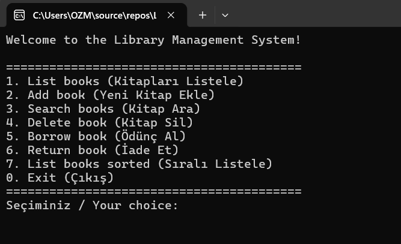
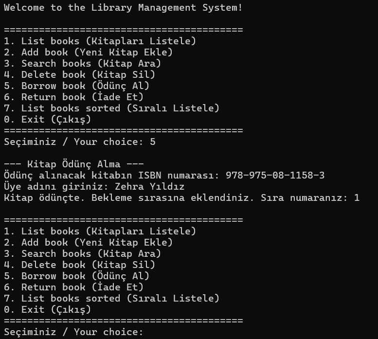
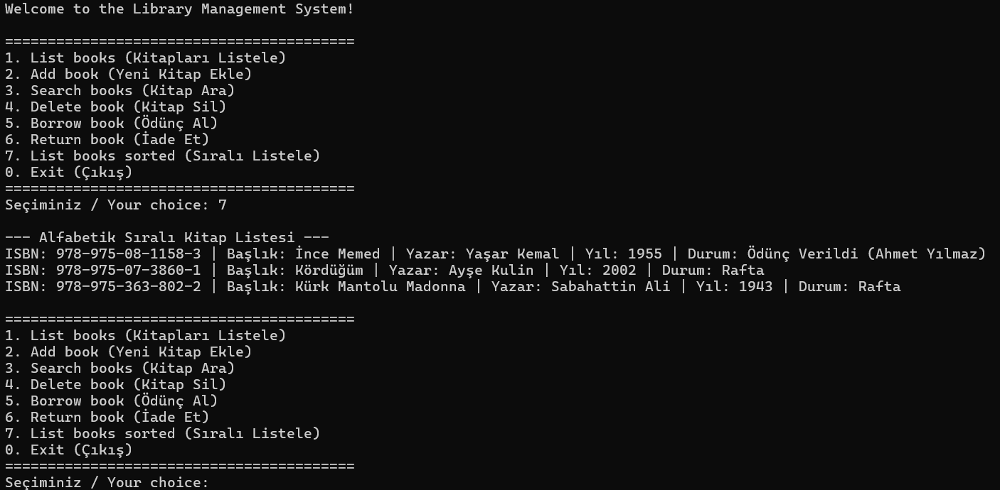

# Library Management System | Kütüphane Yönetim Sistemi

[English](#english) | [Türkçe](#türkçe)

---

## English

A C# console application for managing a small library: adding, searching, borrowing and returning books, with a waiting queue for books that are already checked out.

Built while learning C# and data structures in the BTK Akademi course "Algoritma, Programlama ve Veri Yapılarına Giriş". The on-screen text of the app is in Turkish.

### Features

- Add, list, search and delete books
- Search by title or author (partial match, case-insensitive)
- Borrow and return books
- Waiting queue (first in, first out): when a borrowed book is returned, it is passed to the next person in line automatically
- Alphabetical listing using Turkish culture rules (the same result on every computer)
- Input validation: empty fields, invalid year, duplicate ISBN, the same member borrowing a book twice or joining a queue twice
- A borrowed book (or one with a waiting queue) cannot be deleted

### Screenshots

### Technologies and Concepts

- C# / .NET console application
- Classes, properties and encapsulation (`private set`)
- `Dictionary<string, Book>` for fast lookup by ISBN
- `Queue<string>` for the waiting list
- `IComparable<Book>` for sorting
- `enum` for operation results (`BorrowResult`, `ReturnResult`, `DeleteResult`)
- LINQ (`Any`)

### Project Structure

| File | Responsibility |
|---|---|
| `Book.cs` | Book data and the borrow/return rules |
| `Library.cs` | Stores the books; add, delete, search, sort |
| `Enums.cs` | Result types of operations |
| `Program.cs` | Menu and user input/output |

### How to Run

1. Clone the repository: `git clone https://github.com/zehrasyildiz/library-management.git`
2. Open `LibraryManagement.slnx` in Visual Studio
3. Press F5

### Design Decisions

- **Why `class` and not `struct`?** A book has an identity (the ISBN) and its state changes over time: when it is borrowed, `IsAvailable` and `BorrowedBy` change and people join the waiting queue. `class` is a reference type, so the object I put in the list or dictionary stays one single object, and a change is visible everywhere. With a `struct` (a value type), every assignment would make a copy, and I could change the copy and forget to update the real book.
- **Why `Dictionary`?** The ISBN is unique, so I use it as the key. Finding, adding and deleting a book by ISBN is faster than scanning a whole `List`, and `TryAdd` makes it easy to block a duplicate ISBN. But when I search by title or author, I still check every book one by one, so there is no advantage there.
- **Why is removing items inside a `foreach` a problem?** If I remove an item from a collection while I loop over it with `foreach`, the collection has changed and the program throws an `InvalidOperationException`. That is why I do not delete inside a loop and use `Remove` with the ISBN directly.
- **Why are the borrow/return rules inside `Book`?** I made `IsAvailable` and `BorrowedBy` `private set`, so other code cannot write `book.IsAvailable = true` and skip the rules. Rules like "the same person cannot borrow a book twice" and "when a book is returned, it goes to the next person in the queue" live in one place. `Program.cs` only handles the screen and user input.

### What I Would Improve

- Save data to a database (SQL Server) instead of memory
- Turn the library logic into a Web API with ASP.NET Core
- Add unit tests

---

## Türkçe

Küçük bir kütüphaneyi yönetmek için geliştirilmiş C# konsol uygulaması: kitap ekleme, arama, ödünç verme ve iade alma. Ödünçte olan kitaplar için bekleme sırası vardır.

BTK Akademi'nin "Algoritma, Programlama ve Veri Yapılarına Giriş" kursunda C# ve veri yapılarını öğrenirken geliştirdim. Uygulamanın ekran metinleri Türkçedir.

### Özellikler

- Kitap ekleme, listeleme, arama ve silme
- Başlığa veya yazara göre arama (kısmi eşleşme, büyük/küçük harf duyarsız)
- Kitap ödünç alma ve iade
- Bekleme sırası (ilk gelen ilk alır): ödünçteki kitap iade edilince sıradaki kişiye otomatik verilir
- Türkçe kültür kurallarına göre alfabetik sıralama (her bilgisayarda aynı sonuç)
- Giriş kontrolleri: boş alanlar, geçersiz yıl, tekrar eden ISBN, aynı üyenin aynı kitabı iki kez alması veya sıraya iki kez girmesi
- Ödünçte olan (ya da bekleme sırası olan) kitap silinemez

### Ekran Görüntüleri

Ekran görüntüleri yukarıdaki İngilizce bölümde yer almaktadır.

### Kullanılan Teknolojiler ve Kavramlar

- C# / .NET konsol uygulaması
- Sınıflar, özellikler (property) ve kapsülleme (`private set`)
- ISBN ile hızlı erişim için `Dictionary<string, Book>`
- Bekleme listesi için `Queue<string>`
- Sıralama için `IComparable<Book>`
- İşlem sonuçları için `enum` (`BorrowResult`, `ReturnResult`, `DeleteResult`)
- LINQ (`Any`)

### Proje Yapısı

| Dosya | Görevi |
|---|---|
| `Book.cs` | Kitap verisi ve ödünç/iade kuralları |
| `Library.cs` | Kitapları tutar; ekleme, silme, arama, sıralama |
| `Enums.cs` | İşlem sonuç tipleri |
| `Program.cs` | Menü ve kullanıcı girişi/çıkışı |

### Nasıl Çalıştırılır

1. Depoyu klonla: `git clone https://github.com/zehrasyildiz/library-management.git`
2. `LibraryManagement.slnx` dosyasını Visual Studio'da aç
3. F5 tuşuna bas

### Tasarım Kararları

- **Neden `struct` değil `class`?** Bir kitabın kimliği (ISBN) var ve zamanla durumu değişiyor: ödünç verilince `IsAvailable` ve `BorrowedBy` değişiyor, bekleme sırasına kişi ekleniyor. `class` referans tipi olduğu için listeye ve sözlüğe koyduğum nesne tek bir nesne olarak kalıyor, bir yerde değişirse her yerde güncel görünüyor. `struct` değer tipi olduğu için her atamada kopyası oluşurdu ve değişikliği kopyada yapıp asıl kitabı güncellemeyi unutabilirdim.
- **Neden `Dictionary`?** ISBN benzersiz olduğu için anahtar olarak kullandım. ISBN ile kitap bulmak, eklemek ve silmek `List`'i baştan sona taramaktan daha hızlı ve aynı ISBN'in iki kez eklenmesini `TryAdd` ile kolayca engelliyorum. Ama başlık veya yazara göre ararken yine bütün kitapları tek tek geziyorum, orada bir avantajı yok.
- **`foreach` içinde eleman silmek neden sorun?** Bir koleksiyonu `foreach` ile gezerken aynı koleksiyondan eleman silersem koleksiyon değişmiş olur ve program `InvalidOperationException` hatası verir. Bu yüzden silme işlemini döngünün içinde yapmıyorum, ISBN ile doğrudan `Remove` kullanıyorum.
- **Ödünç/iade kuralları neden `Book` içinde?** `IsAvailable` ve `BorrowedBy` özelliklerini `private set` yaptım, böylece dışarıdan `book.IsAvailable = true` diyerek kuralları atlayamıyorlar. "Aynı kişi aynı kitabı iki kez alamaz" ve "iade edilince sıradaki kişiye otomatik verilir" gibi kurallar tek yerde duruyor. `Program.cs` sadece ekran ve kullanıcı girişiyle ilgileniyor.

### Geliştirme Fikirleri

- Verileri bellek yerine veritabanında (SQL Server) saklamak
- Kütüphane mantığını ASP.NET Core ile Web API'ye dönüştürmek
- Birim testleri eklemek